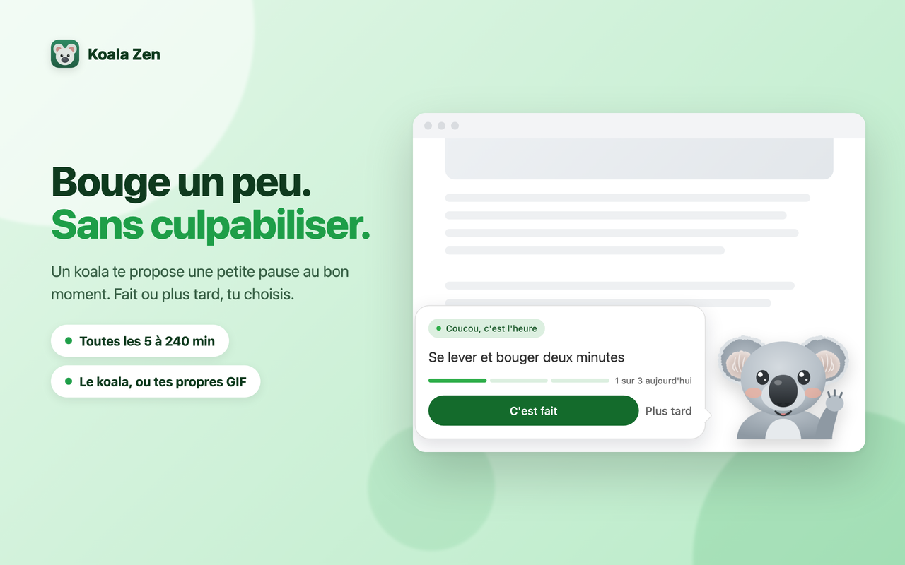
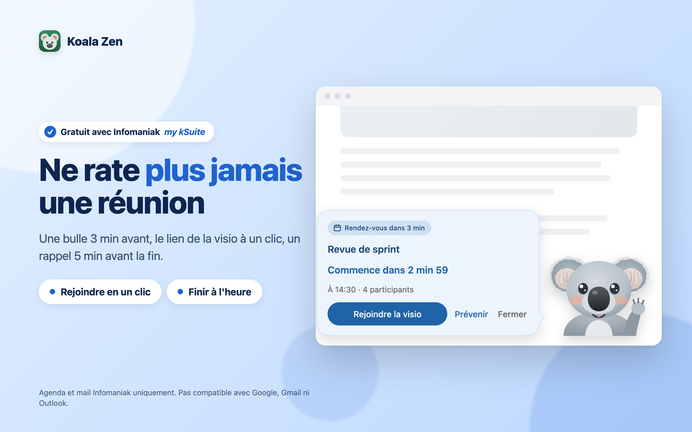
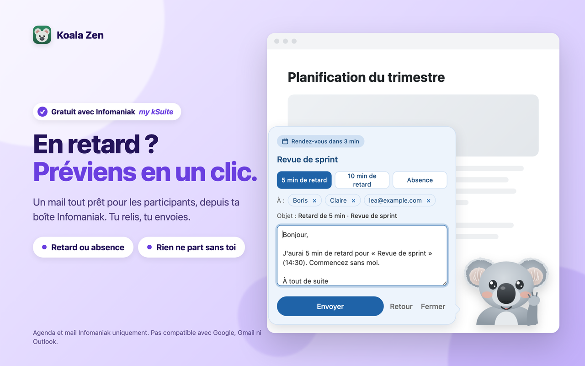
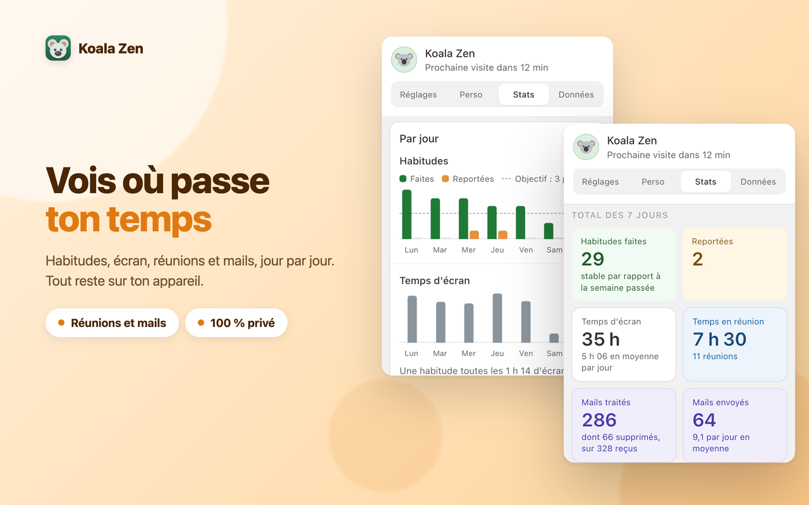
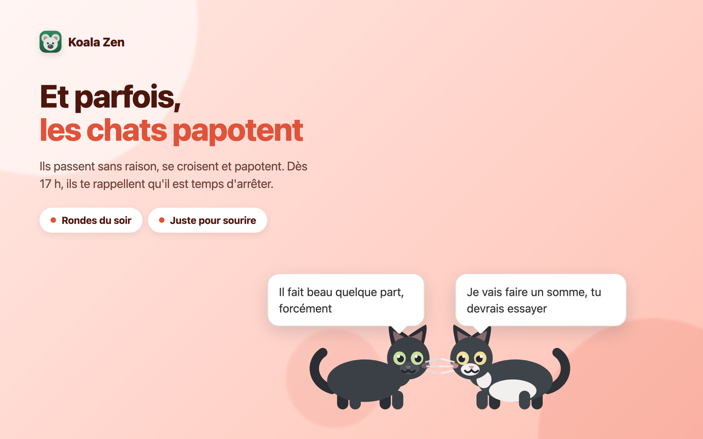
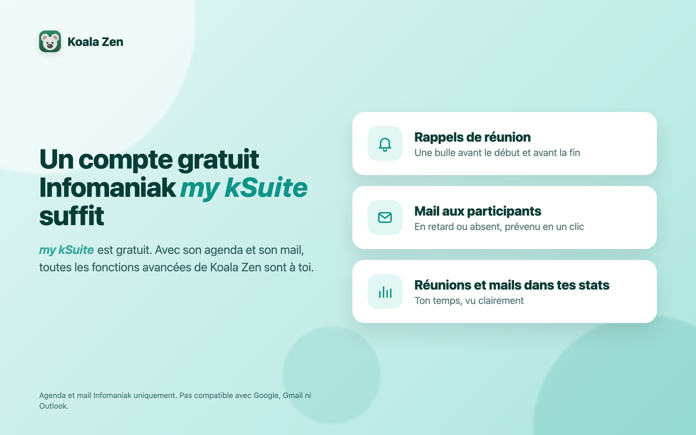

<p align="center">
  
</p>

# Koala Zen

> [English](README.md) · **Français**

**Un koala bienveillant pour ta journée de travail.** Il te rappelle de faire de petites pauses et d'ancrer de bonnes habitudes, te garde à l'heure pour tes réunions, et te montre où passe ton temps. Pour **Chrome et Firefox**, gratuit et open source.

- **Un coup de pouce, jamais de culpabilité.** Toutes les 5 à 240 minutes, un koala te propose une petite chose : te lever, boire un verre d'eau, regarder au loin. Fait ou plus tard, c'est toi qui choisis. Puis il te laisse une courte pensée, parmi une soixantaine de citations. Jamais pendant une visio.
- **Ne rate plus une réunion.** Une bulle 3 minutes avant, avec le lien de la visio à un clic, et un rappel 5 minutes avant la fin. Silence pendant tes réunions.
- **En retard ? Préviens en un clic.** Un mail déjà écrit pour les participants, depuis ta propre boîte. Tu relis, tu envoies.
- **Vois où passe ton temps.** Habitudes, écran, réunions et mails, jour par jour, avec tes séries et tes records.
- **Ton koala à toi.** Remplace-le par tes propres images ou GIF animés (jusqu'à 18), et écris tes propres habitudes et citations.
- **Et parfois, les chats papotent.** Sans aucune raison. Dès 17 h, ils te rappellent, un peu plus fermement chaque heure, qu'il est temps d'arrêter.

> **Un compte Infomaniak *my kSuite*, gratuit, suffit** pour les fonctions avancées : son agenda et son mail débloquent les rappels de réunion, le mail aux participants et les stats de réunions et de mails. **L'agenda et le mail fonctionnent uniquement avec Infomaniak.** Ils ne sont pas compatibles avec Google Agenda, Gmail ni Microsoft Outlook. Tout le reste, pauses, citations, statistiques et animaux de passage, fonctionne pour tout le monde.

**Tes données restent chez toi.** Pas de compte, pas de serveur Koala Zen, aucun suivi. Tout reste dans ton navigateur, et une sauvegarde est un fichier que tu exportes toi-même.

**Nouveau en 2.2 :** rappels de réunion et mail aux participants avec Infomaniak, temps en réunion et mails dans les stats, un mode sombre, une courte présentation au démarrage, des koalas et des chats redessinés, les rondes du soir et du week-end, et une sécurité renforcée. Voir le [journal des versions](CHANGELOG.md), en anglais.

---

## Aperçu

<table>
  <tr>
    <td width="50%" align="center"><br><sub><b>Bouge un peu. Sans culpabiliser.</b></sub></td>
    <td width="50%" align="center"><br><sub><b>Ne rate plus jamais une réunion</b></sub></td>
  </tr>
  <tr>
    <td width="50%" align="center"><br><sub><b>En retard ? Préviens en un clic.</b></sub></td>
    <td width="50%" align="center"><br><sub><b>Vois où passe ton temps</b></sub></td>
  </tr>
  <tr>
    <td width="50%" align="center"><br><sub><b>Et parfois, les chats papotent</b></sub></td>
    <td width="50%" align="center"><br><sub><b>Un compte gratuit Infomaniak my kSuite suffit</b></sub></td>
  </tr>
</table>

---

## Installation

### Firefox, en un clic
Koala Zen est sur les modules complémentaires de Firefox : 👉 https://addons.mozilla.org/fr/firefox/addon/koala-zen/

Tu peux aussi installer [`download/koala-zen-firefox.xpi`](download/koala-zen-firefox.xpi), le même build, signé par Mozilla : ouvre `about:addons`, clique sur la roue crantée, puis sur **Installer un module depuis un fichier**.

### Chrome, Edge, Brave, en une minute environ
Koala Zen n'est pas encore sur le Chrome Web Store, tu l'ajoutes donc à la main. Il reste installé après les redémarrages.
1. Télécharge [`download/koala-zen-chrome.zip`](download/koala-zen-chrome.zip) et dézippe-le.
2. Tape `chrome://extensions` dans la barre d'adresse et valide.
3. Active le **Mode développeur** (l'interrupteur en haut à droite).
4. Clique sur **Charger l'extension non empaquetée** et choisis le dossier obtenu (celui qui contient `manifest.json`).

L'icône du koala apparaît dans la barre d'outils. Clique dessus pour ouvrir le panneau.

---

## Bien démarrer en trois étapes

1. **Suis la courte présentation.** Elle s'ouvre à l'installation : choisis ta première habitude et découvre ce que Koala Zen fait pour toi. Tu peux la revoir depuis le lien sous le numéro de version.
2. **Règle ton rythme.** Dans **Réglages**, choisis Pomodoro (25 min), Deep work (52 min), Ultradien (90 min) ou ton propre intervalle. Dans **Perso**, écris tes habitudes et tes citations, ou ajoute ton propre koala.
3. **Connecte ton agenda Infomaniak** (facultatif). Ça prend deux minutes :
   - dans le Manager Infomaniak, crée un **jeton d'API** ([la marche à suivre](https://www.infomaniak.com/en/support/faq/2582/generate-and-manage-infomaniak-api-tokens)) ;
   - coche **uniquement** le périmètre `workspace:calendar` et donne-lui une date d'expiration ;
   - colle-le dans la carte **Agenda Infomaniak**, puis coche les agendas à surveiller.

   Pour les fonctions mail, crée un second jeton de la même façon, avec **uniquement** le périmètre `workspace:mail`. Un jeton par usage : Koala Zen refuse un jeton qui ouvre plus que nécessaire.

---

## Ce que fait Koala Zen

### Réglages : quand et comment le koala se montre
- **Pause** d'une heure ou jusqu'à demain, et reprise quand tu veux. Ta série est conservée.
- **Pause focus** (facultative) : la page s'assombrit le temps de la pause, pour vraiment t'arrêter.
- **Ne pas déranger** : jamais pendant une visio (kMeet, Teams, Zoom, Google Meet, et les sites que tu ajoutes), jamais quand tu t'éloignes du clavier et, avec Infomaniak, jamais pendant tes réunions. Un rappel qui tombe pendant une réunion passe au prochain créneau libre.
- **Les animaux de passage** : de temps en temps, un chat traverse la page pour dire bonjour, parfois deux chats, ou un chat et un renard. Dès 17 h, un chat passe chaque heure pour te suggérer d'arrêter. Le week-end, il se demande pourquoi tu travailles.
- **Agenda Infomaniak** (facultatif) :
  - une bulle bleue **3 minutes avant** chaque réunion, avec un compte à rebours et **Rejoindre la visio** ;
  - une bulle ambre **5 minutes avant la fin**, pour finir à l'heure ;
  - **Prévenir les participants** : trois messages prêts (5 min de retard, 10 min de retard, absence), les participants en étiquettes que tu peux retirer, un texte que tu peux modifier, et un seul bouton **Envoyer** ;
  - **Compter mes mails** : seulement le nombre de mails par jour, jamais un expéditeur, un objet ni un contenu.

### Perso : ce que le koala montre
- **Objectifs** : tes propres habitudes, dans ton ordre, et **ton objectif par jour**. Chaque habitude au-delà compte en bonus.
- **Citations** : les tiennes, ou celles fournies, que tu peux parcourir, masquer ou modifier.
- **Personnages** : deux koalas dessinés à la main par défaut, ou tes propres images PNG et GIF animés (jusqu'à 18).
- **Thème** (clair, sombre ou automatique) et **animations**.

### Stats : tes progrès
Choisis une période, d'aujourd'hui à depuis le début. Habitudes faites et reportées, temps d'écran, temps en réunion, mails traités et envoyés, chacun avec une ligne de contexte. Des graphiques jour par jour, ton jour le plus chargé, ta série en cours et ton record. Les phrases s'adaptent à tes propres données.

### Données : ta sauvegarde
- **Exporte** un fichier de sauvegarde et **importe**-le à nouveau, en entier ou en partie. Tes connexions Infomaniak sont facultatives dans le fichier et protégées par une phrase secrète d'au moins 12 caractères.
- Vois la place que Koala Zen occupe sur ton appareil.
- **Efface** l'historique, ou tout.

---

## Confidentialité et sécurité

**Par défaut, rien ne quitte ton navigateur.** Tes réglages, habitudes, citations, statistiques et images restent sur ton appareil. Pas de compte, pas de serveur Koala Zen, aucune mesure d'audience, aucun suivi. Rien n'est jamais envoyé dans un cloud.

Seules deux fonctions **facultatives** utilisent le réseau, toutes deux avec ton propre compte Infomaniak et tes propres jetons, et seulement une fois que tu les allumes :
- **L'agenda Infomaniak** lit les événements des agendas que tu as cochés, via `api.infomaniak.com`. Koala Zen ne garde que ce qu'il lui faut pour se taire et te prévenir (début, fin, titre, nombre de participants, lien de visio) et un total de minutes en réunion par jour. L'éteindre efface ces données.
- **Les fonctions mail** passent par `mail.infomaniak.com`. **Prévenir les participants** n'envoie que quand tu cliques Envoyer, seulement aux participants que tu as gardés, et n'en garde rien ensuite. **Compter mes mails** ne lit que le nombre de mails reçus chaque jour.

**Tes jetons.** Donne à chaque jeton un seul périmètre et une date d'expiration. Koala Zen les garde chiffrés sur ton appareil, ne s'en sert que pour ce dont ses fonctions ont besoin, et ne les montre jamais aux pages web. Ils ne quittent ton appareil que dans un fichier de sauvegarde que tu exportes, si tu choisis de les y mettre, chiffrés avec ta phrase secrète. Pour couper l'accès d'un coup, révoque le jeton dans le Manager Infomaniak, ou utilise **Tout effacer** dans l'onglet Données. Comme toute extension de navigateur, Koala Zen ne peut pas protéger tes jetons d'un logiciel malveillant déjà installé sur ton ordinateur.

**Sur les pages web.** Les bulles sont tenues à l'écart du site, rien ne part sans un vrai clic de ta part, et un mail ne peut aller qu'aux participants de la réunion.

**Tu as trouvé un problème de sécurité ?** Signale-le en privé, voir [SECURITY.md](SECURITY.md). N'ouvre pas d'issue publique.

---

## Pour les développeurs

<details>
<summary><b>Construire les paquets</b></summary>

Les paquets prêts à l'emploi sont dans [`download/`](download). Ne les reconstruis que si tu modifies le code :
```bash
bash build.sh
```
Le script produit `dist/koala-zen-chrome.zip` et `dist/koala-zen-firefox.xpi`. Le même `manifest.json` sert aux deux navigateurs ; le script l'adapte pour Firefox.
</details>

<details>
<summary><b>Personnaliser dans le code</b></summary>

- **Citations et habitudes par défaut** : `quotes.js`.
- **Koalas par défaut** : dessinés en SVG dans `KOALA_SVGS`, en haut de `content.js`.
- **Durées du rappel** : l'objet `T` en haut de `content.js`, en millisecondes.
- **Sites de visio par défaut** : `DEFAULTS.mutedPatterns` dans `background.js` et `popup.js`.

Recharge l'extension après avoir modifié un fichier.
</details>

<details>
<summary><b>Installer ta propre version modifiée sur Firefox</b></summary>

La signature de Mozilla ne couvre que le fichier non modifié. Une version que tu as changée a besoin de sa propre signature, gratuite et pour ton seul usage :
1. Dans `manifest.json`, remplace `"id": "koala-zen@public.extension"` par ton propre identifiant, par exemple `"koala-zen@ton-prenom"`. L'identifiant d'origine appartient à la fiche publique.
2. Compresse en `.zip` **les fichiers du dossier** (pas le dossier lui-même).
3. Sur le [tableau de bord développeur de Firefox](https://addons.mozilla.org/fr/developers/), clique sur **Soumettre un nouveau module**, choisis **Sur votre propre serveur**, et envoie ton zip. Mozilla te donne un `.xpi` signé à installer.

Pour essayer un changement sans signer, ouvre `about:debugging#/runtime/this-firefox` et clique sur **Charger un module temporaire**. Il disparaît à la fermeture de Firefox.

Tu préfères le terminal ? `web-ext sign --channel=unlisted` fait la même chose avec une clé d'API de Mozilla. Garde cette clé hors du projet et hors de Git.
</details>

<details>
<summary><b>Structure du projet</b></summary>

```
manifest.json     manifeste de l'extension (Manifest V3, Chrome et Firefox)
background.js     rappels, statistiques, agenda et mail Infomaniak facultatifs
content.js        le koala et les bulles sur la page
passages.js       les animaux de passage
quotes.js         citations, habitudes et répliques des animaux par défaut
popup.html/js     le panneau : Réglages, Perso, Stats, Données
build.sh          construit les paquets Chrome et Firefox
download/         paquets prêts à installer
images/, icons/   koala d'accueil et icônes de la barre d'outils
store-assets/     captures en trois langues
tests/            tests automatiques
```
</details>

Pas à l'aise avec une étape ? Un assistant IA comme **Euria d'Infomaniak** peut te guider pas à pas.

---

## Licence
MIT. Voir [LICENSE](LICENSE).
