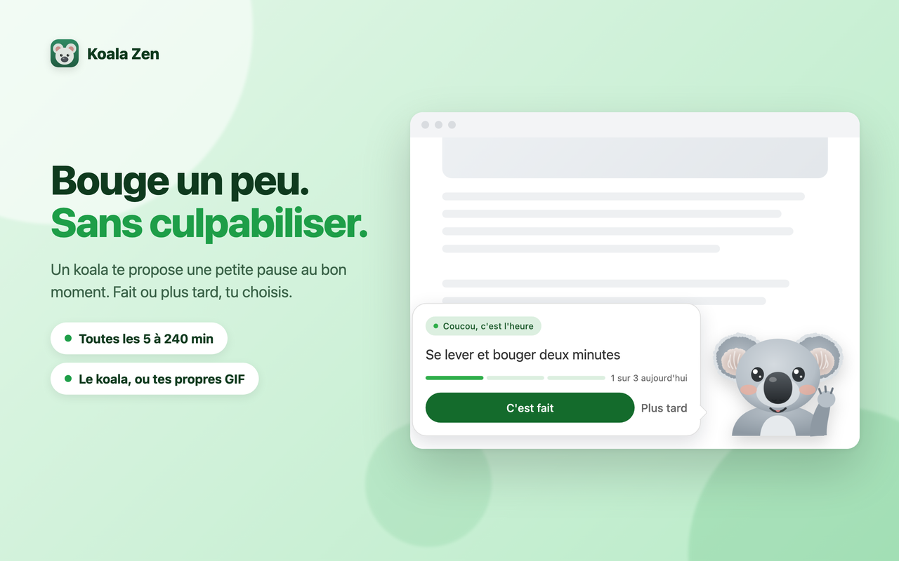
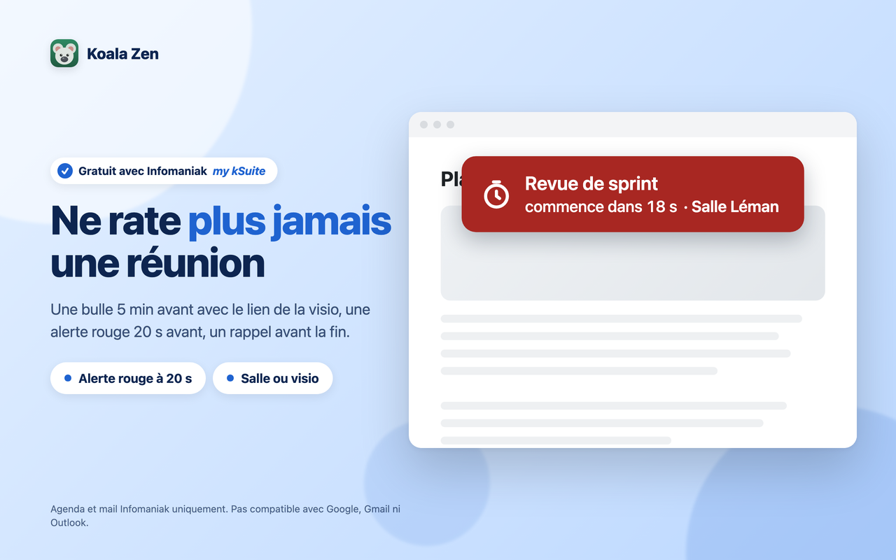
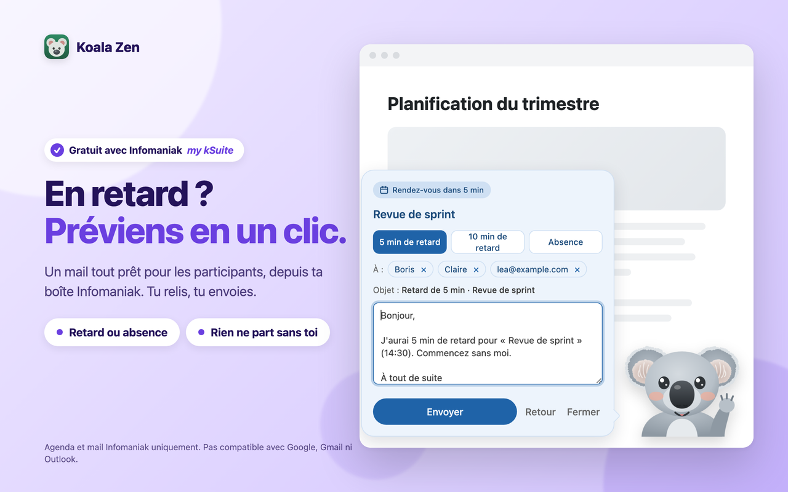
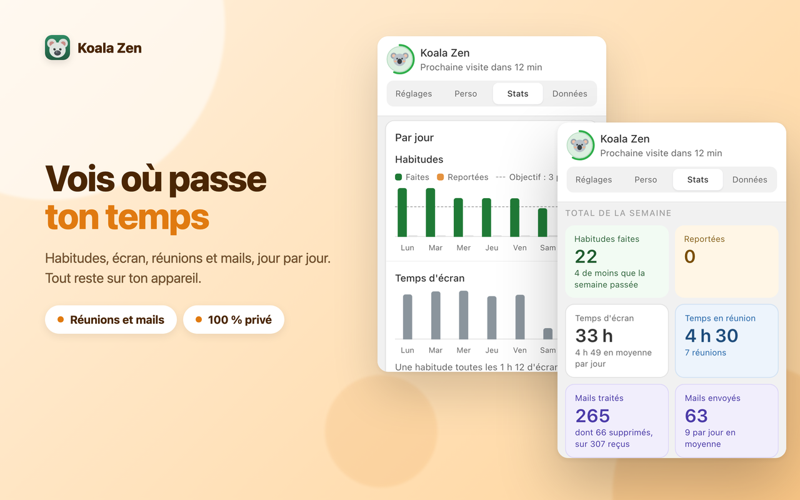
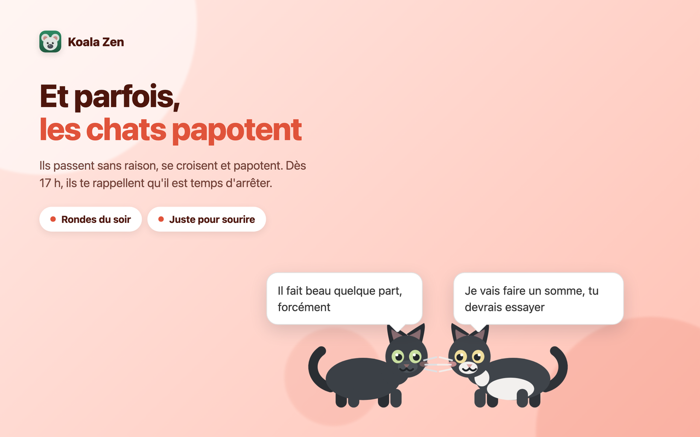
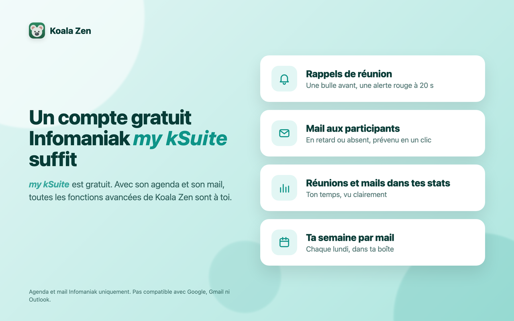

  

# Koala Zen

> [English](README.md) · **Français**

**Un koala bienveillant pour ta journée de travail.** Il te rappelle de faire de petites pauses, te garde à l'heure pour tes réunions, et te montre où passe ton temps. Pour **Chrome et Firefox**, gratuit et open source.

- **De petites pauses, sans culpabiliser.** Toutes les 5 à 240 minutes, un koala te propose une petite chose : te lever, boire un verre d'eau, reposer tes yeux. Fait ou plus tard, tu choisis. Jamais pendant une visio.
- **À l'heure à chaque réunion.** Une bulle 5 minutes avant (10 pour une salle), avec le lien de la visio à un clic, puis une alerte rouge 20 secondes avant. Vers la fin, un rappel 6 minutes avant, rouge les 2 dernières.
- **En retard ? Dis-le en un clic.** Un mail déjà écrit pour les participants : tu relis, tu envoies. L'alerte rouge passe à ta nouvelle heure d'arrivée.
- **Des stats honnêtes.** Une réunion qui n'a pas eu lieu sort en un clic. Celle qui finit plus tôt ne compte que jusqu'à ton clic sur Terminer.
- **Vois où passe ton temps.** Habitudes, écran, réunions et mails, jour par jour. Et si tu veux, ta semaine par mail chaque lundi.
- **À ton image.** Tes propres images ou GIF, tes habitudes et tes citations. Ou un style sobre, sans personnage.
- **Et parfois, les chats papotent.** Dès 17 h, ils te rappellent qu'il est temps d'arrêter.

> **Un compte Infomaniak *my kSuite*, gratuit, suffit** pour les fonctions réunion et mail. Elles fonctionnent **uniquement avec Infomaniak**, pas avec Google Agenda, Gmail ni Microsoft Outlook. Tout le reste fonctionne pour tout le monde.

**Tes données restent chez toi.** Pas de compte, pas de serveur Koala Zen, aucun suivi.

<table>
  <tr>
    <td width="50%" align="center"></td>
    <td width="50%" align="center"></td>
  </tr>
  <tr>
    <td width="50%" align="center"></td>
    <td width="50%" align="center"></td>
  </tr>
  <tr>
    <td width="50%" align="center"></td>
    <td width="50%" align="center"></td>
  </tr>
</table>

## Installation

**Firefox :** en un clic sur les [modules complémentaires de Firefox](https://addons.mozilla.org/fr/firefox/addon/koala-zen/).

**Chrome, Edge, Brave** (pas encore sur le Chrome Web Store) :
1. Télécharge [`koala-zen-chrome.zip`](download/koala-zen-chrome.zip) et dézippe-le.
2. Ouvre `chrome://extensions` et active le **Mode développeur** (en haut à droite).
3. Clique sur **Charger l'extension non empaquetée** et choisis le dossier dézippé.

## Bien démarrer

1. Suis la courte présentation qui s'ouvre à l'installation. Elle règle ton rythme et tes habitudes, et connecte Infomaniak si tu veux. À la fin, avec ton agenda connecté, **Tester un rendez-vous** joue une réunion complète en 3 minutes.
2. Pour l'agenda et le mail (facultatif) : dans le Manager Infomaniak, crée un jeton d'API ([la marche à suivre](https://www.infomaniak.com/en/support/faq/2582/generate-and-manage-infomaniak-api-tokens)) avec une date d'expiration et le périmètre `workspace:calendar`, plus `workspace:mail` pour le mail. Un jeton ou deux, comme tu préfères. Tout autre périmètre est refusé.
3. Sur macOS, règle ton navigateur sur **Alertes** dans Réglages Système > Notifications. Les rappels de réunion qui arrivent quand une autre app est devant restent alors jusqu'à ce que tu les fermes.

## Dans le panneau

- **Réglages :** rythme, pause, pause focus, ne pas déranger, animaux de passage, et ton agenda Infomaniak.
- **Perso :** habitudes et objectif par jour, citations, ton propre koala, thème.
- **Stats :** habitudes, écran, réunions et mails, avec ta série et ton record, et Ta semaine, qui peut t'arriver par mail chaque lundi.
- **Données :** exporter ou importer un fichier de sauvegarde, effacer tes données.

## Confidentialité

- Tout reste dans ton navigateur.
- Les fonctions Infomaniak sont facultatives, utilisent tes propres jetons et ne parlent qu'à Infomaniak. Aucun mail ne part sans un clic de ta part, sauf le bilan de la semaine que tu allumes, qui ne va qu'à une adresse de ta propre boîte.
- Pour couper l'accès à tout moment, révoque ton jeton dans le Manager Infomaniak.
- Un problème de sécurité ? Signale-le en privé, voir [SECURITY.md](SECURITY.md).

## Construire depuis les sources

`bash build.sh` crée les deux paquets dans `dist/`.

## Licence

MIT, voir [LICENSE](LICENSE). Les nouveautés sont dans le [journal des versions](CHANGELOG.md), en anglais.
