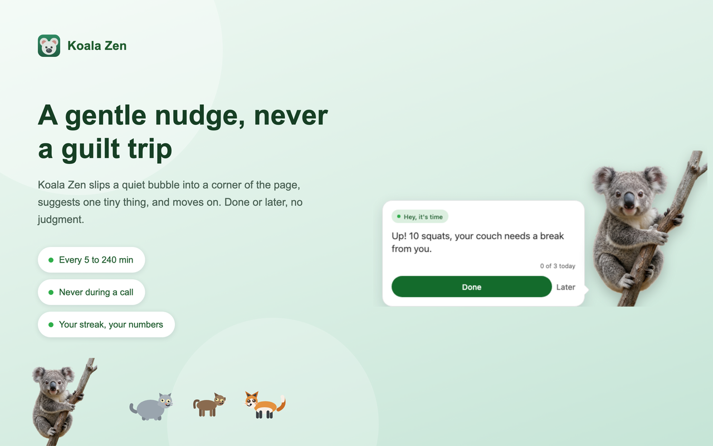
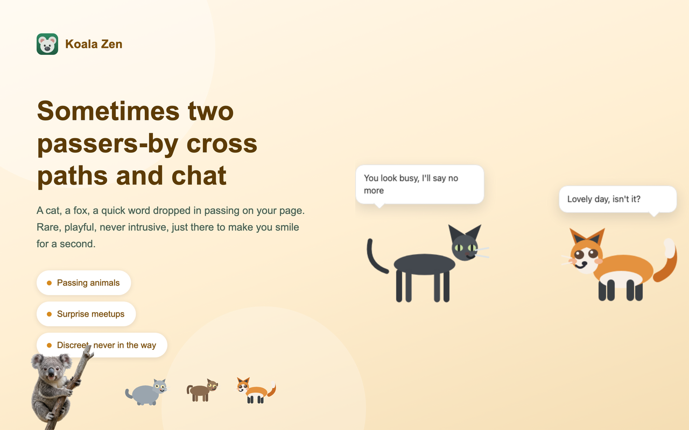
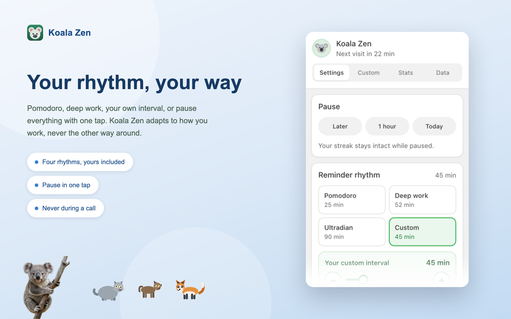
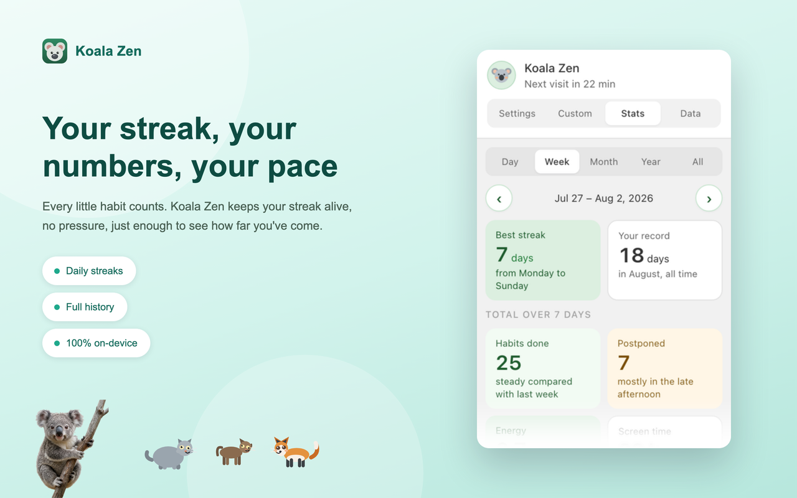
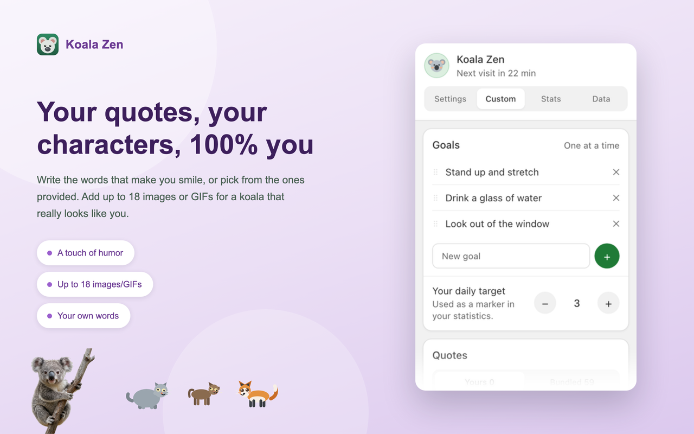

<p align="center">
  
</p>

# Koala Zen

> **English** · [Français](README.fr.md)

A small browser extension for **Chrome and Firefox**. Every 30 minutes, an adorable koala pops up on the page. First it nudges you to do the habit you want to build, moving by default, but you choose. Then it comes back to whisper a short piece of wisdom, and leaves in a different, playful way each time. The koala changes on every visit: three photos, or your own.

- **Set your habit goals** ("Do 3 push-ups", "Drink a glass of water"), reorder them by dragging, and they come up one at a time, in order. Confirm each as done and rate your energy from 1 to 10.
- **See where you are in the day**: the reminder shows one mark per goal and how many you have already done.
- **A cat that just drops by, sometimes with a fox**: it wanders across the page, waves and leaves. Every now and then two passers-by cross paths, two cats, or a cat and a fox, and trade a quick joke before moving on. It asks for nothing, counts for nothing, it is simply there. Five different scenes, between 8am and 8pm, and never during a call or a pause. Choose how often: Rare (every 3h), Normal (every 2h, the default), or Frequent (every hour) — or switch it off in one click if you prefer quiet.
- **Follow your progress**: pick day, week, month, year or everything, then move back through past periods with the arrows. Habits done, habits postponed, average energy and screen time, each with a line that reads the number rather than repeating it, how it compares with the previous period, the time of day you postpone most, whether your energy is rising or easing and since when. A per-day chart with your daily target as a dashed line, a screen time chart, your best streak and your all-time record.
- **Back up and restore**: export a `.json` file with the parts you choose, settings, goals and quotes, statistics, imported characters. Re-import it here or on another machine, merging or replacing. A storage bar shows what takes up room, and you can erase the history alone or everything. **Optionally, also back up to your own kDrive** (Apps/Koala Zen folder) with an Infomaniak access token you provide, restore from there the same way.
- **Choose your rhythm**: Pomodoro, Deep work, Ultradian, or your own interval, from 5 to 240 minutes in steps of five. Your custom value is remembered even when you switch to a preset.
- **Snooze or pause** (later, 1 hour, the whole day) and catch up the breaks you missed.
- **Automatic pause** during video calls (kMeet, Teams, Zoom, Meet) and when you step away from the keyboard. The header tells you when it is staying quiet.
- **Optional focus mode**: a break that dims the page until the timer ends. Off by default, and the countdown is announced to screen readers.
- **See your screen time**: the wisdom bubble tells you how long you have been active on the computer today. It resets at midnight in the time zone you choose (Europe/Zurich by default, or your browser's).
- Around 60 quotes, from Buddha and Rumi to Marcus Aurelius and Steve Jobs. **Browse them all**, search, hide the ones you do not like, or copy one into your own list. Add your own one by one, or **paste a whole batch at once** with one quote per line, checked on screen before anything is added.
- **Someone with an opinion**: postpone and one of five characters turns up in a graphite bubble, counting your postponements on a tally. A different one each time, starting over every morning. Give up for good and it bursts into tears, briefly, asking nothing.
- Bring **your own images or GIFs** too, up to 18. Squares and portraits get the bubble beside them, wide ones get it above.
- **Interface in French, German, and English**, following your browser's language.
- Everything stays on your computer by default, no account, no tracking, no analytics — an optional kDrive backup is the only thing that ever leaves it, and only if you turn it on yourself.

---

## Overview

The koala nudges you to do your habit, then whispers a thought. Everything is tuned from one panel, and you follow your progress.

<table>
  <tr>
    <td width="50%" align="center"><br><sub><b>A gentle nudge, never a guilt trip</b></sub></td>
    <td width="50%" align="center"><br><sub><b>Sometimes two passers-by cross paths and chat</b></sub></td>
  </tr>
  <tr>
    <td width="50%" align="center"><br><sub><b>Your rhythm, your way</b></sub></td>
    <td width="50%" align="center"><br><sub><b>Your streak, your numbers, your pace</b></sub></td>
  </tr>
  <tr>
    <td colspan="2" align="center"><br><sub><b>Your quotes, your characters, 100% you</b></sub></td>
  </tr>
</table>

---

## Installation

Koala Zen works on **Chrome and Firefox**. Pick your browser below. The ready-to-use packages are in the [`download/`](download) folder. The `.xpi` in `download/` is already **signed by Mozilla**, ready to install directly.

### Chrome, Edge, Brave (the simplest, about a minute)
The extension isn't on the Chrome Web Store yet, so you add it by hand. It stays installed across restarts, just leave developer mode on.
1. Download [`download/koala-zen-chrome.zip`](download/koala-zen-chrome.zip) and unzip it.
2. In Chrome, type `chrome://extensions` in the address bar and press Enter.
3. Turn on **Developer mode** (the switch in the top-right corner).
4. Click **Load unpacked**, then pick the unzipped folder (the one that contains `manifest.json`).

The koala icon appears in your toolbar. Click it to open the settings.

### Firefox
Regular Firefox only installs extensions **signed by Mozilla**, which [`download/koala-zen-firefox.xpi`](download/koala-zen-firefox.xpi) already is. It installs permanently, no account and no command line needed.

1. Open `about:addons`, click the gear icon, then **Install Add-on From File**, and pick [`download/koala-zen-firefox.xpi`](download/koala-zen-firefox.xpi) (you can also drag the file onto the Firefox window).
2. Confirm. Because the file is signed, it stays installed across restarts.

**Try it without installing (temporary)**
The extension disappears when you close Firefox.
1. Type `about:debugging#/runtime/this-firefox` in the address bar.
2. Click **Load Temporary Add-on** and pick the `.xpi`.

**If you modified the code, sign your own build (free)**
The provided signature only covers the unmodified file above, so a build you changed needs its own. It all happens in the browser, no command line. You submit it to AMO as a **private distribution**: Mozilla signs it for your own use, with no public page.
1. Create a free Firefox account at https://accounts.firefox.com, then open the developer dashboard: https://addons.mozilla.org/en-US/developers/
2. **Set your own add-on ID.** Open `manifest.json`, find `"id": "koala-zen@public.extension"` and replace it with an ID of your own, for example `"id": "koala-zen@your-name"`. The original ID is reserved for the public page. Then select **all the files inside the folder** (not the folder itself) and compress them into a `.zip`.
3. Click **Submit a New Add-on**, choose **On your own** (private, unlisted), upload your `.zip`, and Mozilla offers a **signed** `.xpi` to download.
4. Install that signed `.xpi` the same way as above.

Not comfortable with these steps? An AI like **Euria by Infomaniak** can walk you through them. Paste it the instructions above and describe where you're stuck.

**Once the public page is live**
After Mozilla validates and publishes the extension, anyone will be able to install it in one click from:

👉 https://addons.mozilla.org/en-US/firefox/addon/koala-zen/

---

## Signing with the command-line API (alternative)
*For people comfortable with a terminal who prefer to automate the signing. The result is the same as the recommended method above: a `.xpi` signed for private use. It is more technical, so each step is spelled out.*

Your API credentials never go inside the extension. They are used only by the `web-ext sign` command, on your machine.

1. **Set your own add-on ID**, as in step 2 of the recommended method: in `manifest.json`, replace `"id": "koala-zen@public.extension"` with your own.
2. Create an API key at https://addons.mozilla.org/developers/addon/api/key/. Mozilla gives you **two** values:
   - a **JWT issuer**, the "API key" (it looks like `user:12345:678`).
   - a **JWT secret**, a long random string shown **only once**, at creation. Copy it right away. If you lose it, generate a new key.
3. Install the tool: `npm install -g web-ext`
4. From the project folder (the one with `manifest.json`), run **one** of:
   ```bash
   web-ext sign --channel=unlisted --api-key=YOUR_ISSUER --api-secret=YOUR_SECRET
   ```
   or, to keep the values out of the command line:
   ```bash
   export WEB_EXT_API_KEY="YOUR_ISSUER"
   export WEB_EXT_API_SECRET="YOUR_SECRET"
   web-ext sign --channel=unlisted
   ```
   `--channel=unlisted` means private distribution, not listed in the public gallery.
5. The signed `.xpi` lands in `web-ext-artifacts/`. Install it as in step 6 of the recommended method (drag it into a Firefox window, or `about:addons` then **Install Add-on From File**). It stays installed across restarts.

> **Keep these two values private.** Never commit them to Git or place them in any project file. The included `.gitignore` already excludes `web-ext-artifacts/`.

Need help with a step? Here too, an AI like **Euria by Infomaniak** can get you unstuck.

*Alternative without a Mozilla account (Firefox Developer Edition or ESR only):* set `xpinstall.signatures.required` to `false` in `about:config`, then open the `.xpi`. This switch is ignored on regular Firefox.

---

## Plugin settings
**Everything in Koala Zen is customizable.** Click the koala icon in the toolbar to open the panel. The header shows when the next visit is due, and there are four tabs: **Settings** (how and when the koala shows up), **Custom** (what it shows), **Stats** (your progress) and **Data** (backup and erasing).

**Settings** tab, in order:
- **Pause**: postpone the next appearance (**Later**), pause for **1 hour**, or stop for **today**. A **Resume** button cancels the pause at any time, and your streak stays intact while paused.
- **Catch up**: if you postpone or miss breaks, an amber banner shows how far behind you are and lets you make one up.
- **Reminder rhythm**: pick **Pomodoro** (25 min), **Deep work** (52 min), **Ultradian** (90 min), or **Custom** and set the interval yourself with the slider (5 to 240 minutes, in steps of five).
- **Focus break** (off by default): the page is dimmed for the length of the break, so you really do stop. You choose the duration.
- **Passing animals** (on by default): a cat walks across the page to say hello and leaves. It asks nothing and counts for nothing. Sometimes two cats, or a cat and a fox, cross paths and greet each other in turn. At most one every two hours, four a day, only between 8am and 8pm, and never during a call, a pause or a focus break.
- **The heads-up before a call** (follows the same setting as passing animals): two seconds after landing on one of the listed videoconference pages, the cat walks by once with a teasing line about the meeting that is about to start.
- **Do not disturb**: **during a video call** (the koala never appears on the listed sites, by default `kmeet.infomaniak.com`, `teams.microsoft.com`, `teams.live.com`, `zoom.us`, `meet.google.com`, and subdomains are covered, so `zoom.us` also covers `us02web.zoom.us`) and **when you leave the keyboard**.
- **Screen time**: choose the time zone that defines your day for the counter shown in the bubbles. Europe/Zurich by default, or **Automatic (browser)**.

At the bottom, **Bring the koala** triggers an immediate appearance, handy for testing, and it ignores the video-call pause. The version and last-update date are shown discreetly underneath.

**Custom** tab, in order:
- **Goals**: your habit prompts. Add them one by one, remove with ×, and drag the handle to reorder. They come up one at a time, in your order. Leave the list empty to use the bundled goals. Underneath, **your daily target** sets the number of habits you aim for each day, and it drives the marks in the reminder and the dashed line in the statistics.
- **Quotes**: switch between **Yours** and **Bundled**. Add your own as "Text | Author" (the author is optional). **Browse the bundled ones** opens a full list where you can search, **hide** a quote so the koala stops saying it, or **edit** one, which creates your own version and leaves the original untouched.
- **Characters**: add your own PNG or animated GIF files (a transparent background works best). They replace the bundled koalas unless you tick **Keep the bundled koalas**. Click × to remove one. Static images are resized to save space, and everything stays on your device.
- **Animations**: **Automatic** follows your system's reduced-motion setting, or force them **Always** or **Never**.

Click **Save** on either tab after a change.

**Stats** tab. Pick a period (today, yesterday, this or last week, this or last month, since you started) and read four figures, each with a line of context: habits done compared with the previous period, habits postponed with the time of day you postpone most, average energy with its trend, and screen time with a daily average. Below, a per-day chart for habits (done and postponed side by side) with your daily target as a dashed line, a per-day chart for screen time, and a cadence line tying your habits to your screen time. Then your current streak as a progress bar toward your record, and how your average energy compares on days you do a little versus a lot. The wording adapts to your own data, so it never claims a link that is not there. On the very first run, the tab shows what will appear and when instead of a wall of zeros.

**Data** tab:
- **Backup and restore**: one card, two destinations. Tick the parts you want (settings, goals and quotes, statistics, imported characters, each with its weight) and choose **merge** or **replace** for restoring — both choices apply to whichever destination you use below. **Local file**: **Export** a `.json` file, **Import** brings it back. **kDrive** (optional): paste a personal Infomaniak access token with the kDrive scope ([how to get one](https://faq.infomaniak.com/2582)) to back up and restore the exact same data to your own kDrive, folder `Apps/Koala Zen`. If your account has more than one kDrive, you pick which one; with only one, it connects straight away. A "Change kDrive" link lets you switch later. Nothing is sent until you provide a token and connect; disconnect any time to stop. The token is encrypted at rest and never included in the local `.json` export.
- **What Koala Zen takes up**: a gauge splitting your storage between characters, history and content.
- **Everything stays with you**: no account, nothing sent, no analytics — unless you turn on kDrive backup above.
- **Erase**: the history alone, or everything including settings and content. Both ask for a second click to confirm, so export first.

The koala appears on the active web page, not on the browser's internal pages (`chrome://`, `about:`…), which don't allow extensions.

---

## Build the packages from source (optional)
The already-built packages are in [`download/`](download). Rebuild them only if you change the code. One script regenerates both, in `dist/`:
```bash
bash build.sh
```
- `dist/koala-zen-chrome.zip` for Chrome, Edge, Brave or the Chrome Web Store.
- `dist/koala-zen-firefox.xpi` for Firefox and addons.mozilla.org, with zero validator errors, warnings, or notices.

The committed `manifest.json` targets both engines. For Firefox the script drops the Chrome-only `service_worker` key and sets the minimum versions that understand `data_collection_permissions`, which keeps the AMO report clean. The `dist/` folder is git-ignored.

---

## Customisation in the code
- **Default quotes and prompts** live in `quotes.js` (`KZ_QUOTES` = `{ t, a }`, `KZ_SPORT` = the default habit prompts). Most people can just use the settings above.
- **Default images**: replace the files in `images/` and update `DEFAULT_KOALAS` at the top of `content.js`. The cat lines and images are `KZ_SNARK` in `quotes.js` and `SNARK_KOALAS` in `content.js`.
- **Reminder timings**: the `T` object at the top of `content.js` holds every duration of the choreography, in milliseconds.
- **Default video-call sites**: `DEFAULTS.mutedPatterns` in `background.js` and `popup.js`.

Reload the extension after editing any file.

## Project structure
```
manifest.json     extension manifest (Manifest V3, Chrome + Firefox)
background.js     service worker: schedules reminders, applies the video-call pause,
                  tracks daily active screen time and the daily statistics,
                  and talks to the kDrive API for the optional cloud backup
content.js        draws the koala, the bubbles and the reminder choreography
passages.js       the passing-animals scenes (cats, and occasional cat/fox meetings)
quotes.js         the default quotes, habit prompts and cat lines
popup.html/js     the four-tab panel: Settings, Custom, Stats, Data
rules.json        declarativeNetRequest rule that strips the Origin header on
                  requests to api.infomaniak.com, required for the kDrive backup
build.sh          builds the Chrome (.zip) and Firefox (.xpi) packages
download/         ready-to-install packages (Chrome .zip, Firefox .xpi)
images/           the default koalas and the cat (PNG)
icons/            toolbar icons
store-assets/     listing text and screenshots for the add-on stores
```

## Privacy
By default, nothing leaves your browser. Your settings, your goals and quotes, your statistics and any images you add are stored locally with the browser's storage API. Export and import go through a file you handle yourself. No servers, no analytics, no tracking.

The one exception is the **optional** kDrive backup in the Data tab: if you paste your own Infomaniak access token and connect, Koala Zen uploads the same data as the local export to your own kDrive, folder `Apps/Koala Zen`, only when you click "Back up" (or restore from there). Nothing is sent before you do this, and disconnecting stops it. The token is encrypted at rest in the extension's local storage and is never included in the `.json` export file. This requires the `declarativeNetRequest` permission (to strip a browser-added header that would otherwise break the request) and reaches only `api.infomaniak.com`.

## License
MIT. See [LICENSE](LICENSE).
