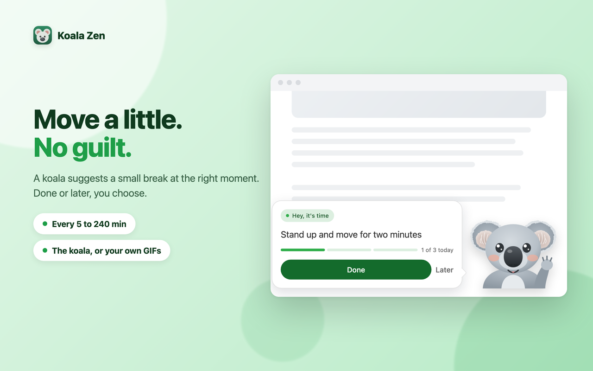
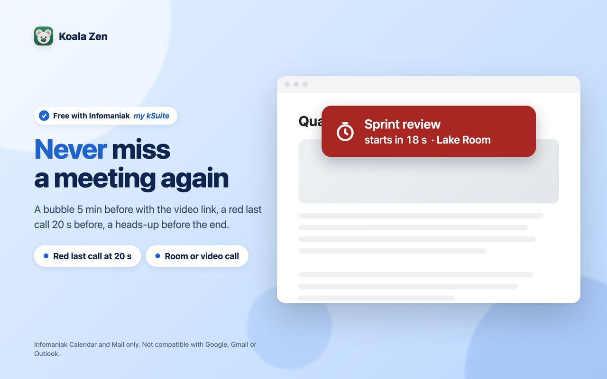
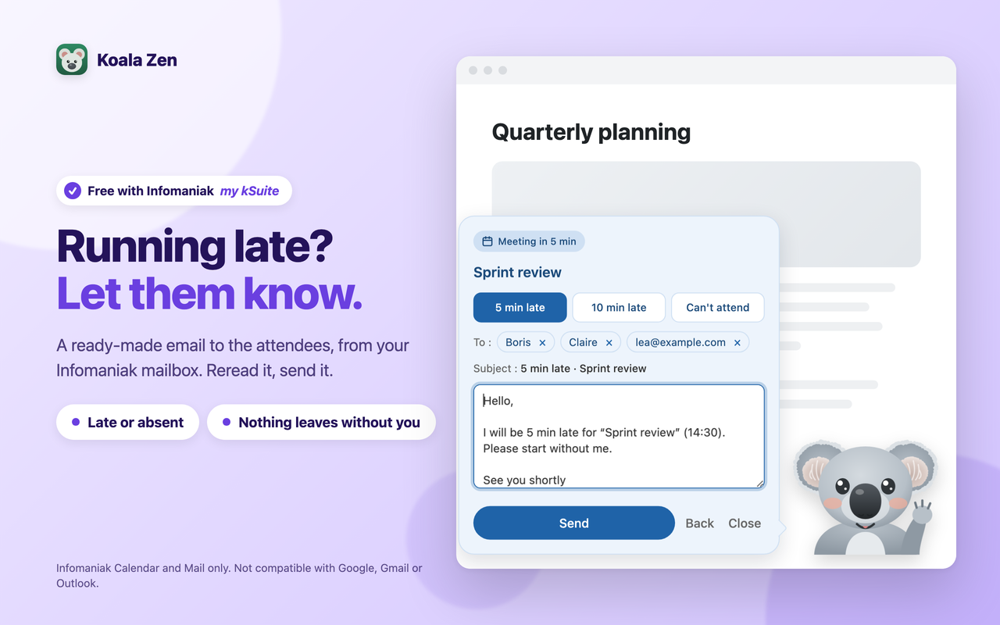
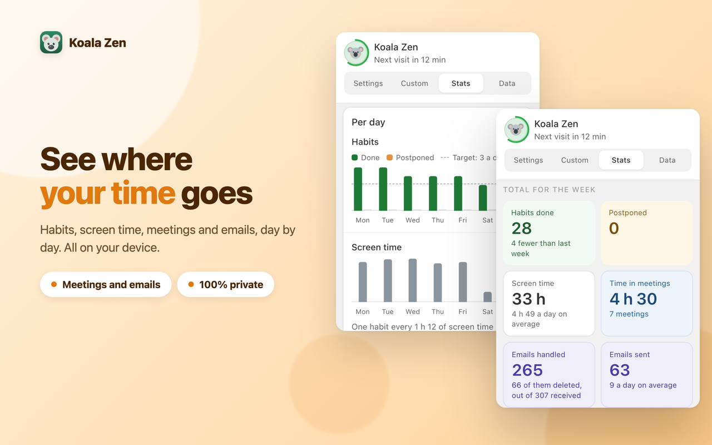
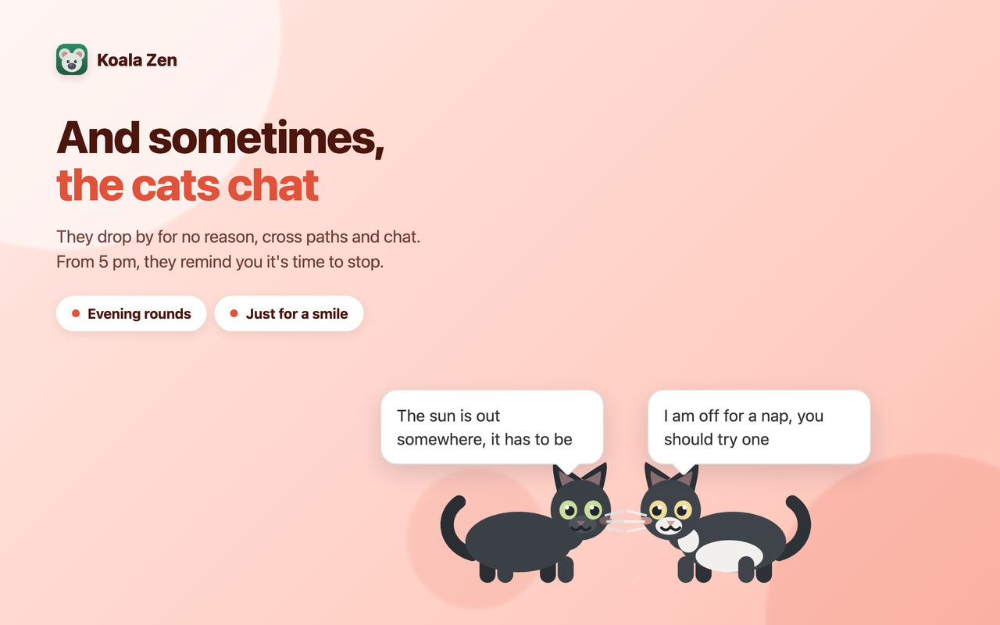
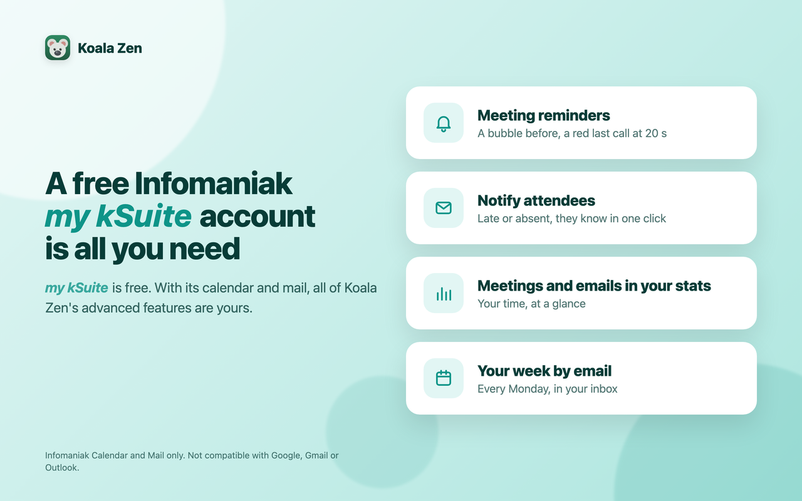

  

# Koala Zen

> **English** · [Français](README.fr.md)

**A friendly koala for your workday.** It reminds you to take small breaks, keeps you on time for your meetings, and shows you where your time goes. For **Chrome and Firefox**, free and open source.

- **Small breaks, no guilt.** Every 5 to 240 minutes, a koala suggests one small thing: stand up, drink some water, rest your eyes. Done or later, you choose. Never during a video call.
- **On time for every meeting.** A bubble 5 minutes before (10 for a room), with the video link one click away, then a red last call 20 seconds before. Near the end, a heads-up 6 minutes before, red for the last 2.
- **Running late? Say so in one click.** A ready-made email to the attendees: reread it, send it. The last call moves to your new arrival time.
- **Stats that tell the truth.** A meeting that didn't happen comes out in one click. One that ends early counts only until you click Finish.
- **See where your time goes.** Habits, screen time, meetings and emails, day by day. And if you want, your week by email every Monday.
- **Make it yours.** Your own images or GIFs, habits and quotes. Or a sober style, with no characters.
- **And sometimes, the cats chat.** From 5 pm, they remind you it's time to stop.

> **A free Infomaniak *my kSuite* account is all you need** for the meeting and email features. They work **with Infomaniak only**, not with Google Calendar, Gmail or Microsoft Outlook. Everything else works for everyone.

**Your data stays yours.** No account, no Koala Zen server, no tracking.

<table>
  <tr>
    <td width="50%" align="center"></td>
    <td width="50%" align="center"></td>
  </tr>
  <tr>
    <td width="50%" align="center"></td>
    <td width="50%" align="center"></td>
  </tr>
  <tr>
    <td width="50%" align="center"></td>
    <td width="50%" align="center"></td>
  </tr>
</table>

## Install

**Firefox:** one click on [Firefox Add-ons](https://addons.mozilla.org/en-US/firefox/addon/koala-zen/).

**Chrome, Edge, Brave** (not on the Chrome Web Store yet):
1. Download [`koala-zen-chrome.zip`](download/koala-zen-chrome.zip) and unzip it.
2. Open `chrome://extensions` and turn on **Developer mode** (top right).
3. Click **Load unpacked** and pick the unzipped folder.

## Get started

1. Follow the short tour that opens on install. It sets your rhythm and your habits, and connects Infomaniak if you want. At the end, with your calendar connected, **Try a meeting** plays a full meeting in 3 minutes.
2. For the calendar and email features (optional): in the Infomaniak Manager, create an API token ([how to](https://www.infomaniak.com/en/support/faq/2582/generate-and-manage-infomaniak-api-tokens)) with an expiry date and the `workspace:calendar` scope, plus `workspace:mail` for email. One token or two, as you like. Any other scope is refused.
3. On macOS, set your browser to **Alerts** in System Settings > Notifications. Meeting reminders that arrive while another app is in front then stay until you close them.

## In the panel

- **Settings:** rhythm, pause, focus break, do not disturb, passing animals, and your Infomaniak calendar.
- **Custom:** habits and daily target, quotes, your own koala, theme.
- **Stats:** habits, screen time, meetings and emails, with your streak and record, and Your week, which can be emailed to you every Monday.
- **Data:** export or import a backup file, erase your data.

## Privacy

- Everything stays in your browser.
- The Infomaniak features are optional, use your own tokens, and talk only to Infomaniak. No email leaves without a click from you, except the weekly report you turn on, which goes only to an address of your own mailbox.
- To cut access at any time, revoke your token in the Infomaniak Manager.
- Found a security issue? Report it privately, see [SECURITY.md](SECURITY.md).

## Build from source

`bash build.sh` creates both packages in `dist/`.

## License

MIT, see [LICENSE](LICENSE). Changes in the [changelog](CHANGELOG.md).
