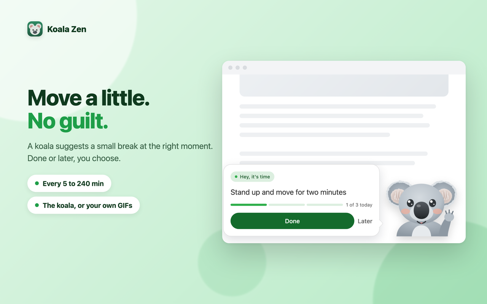
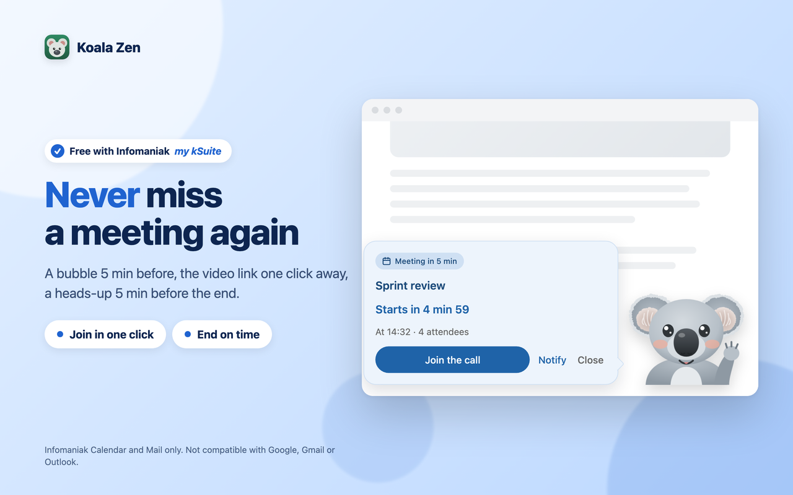
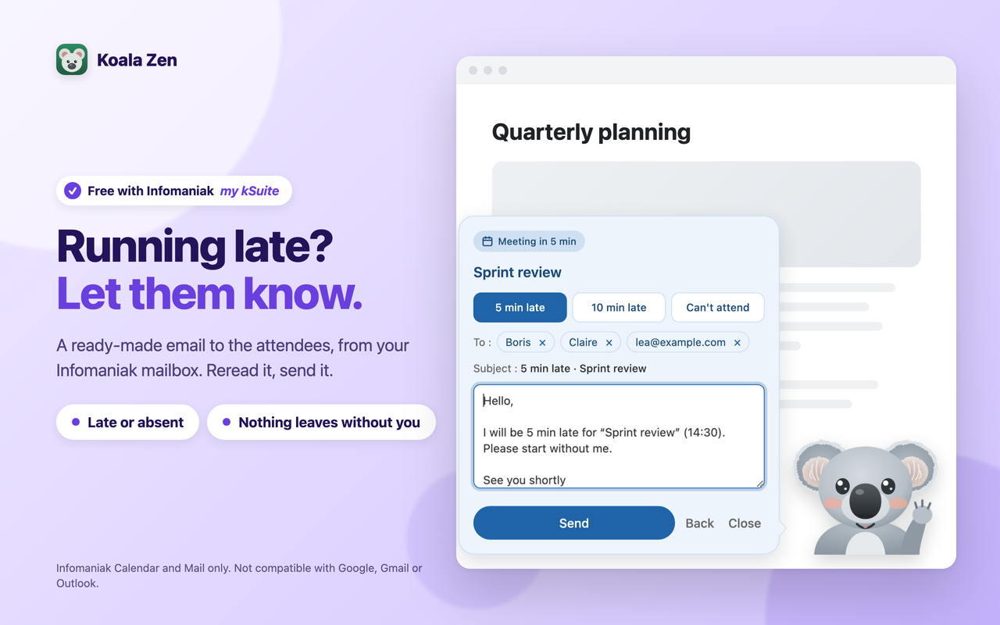
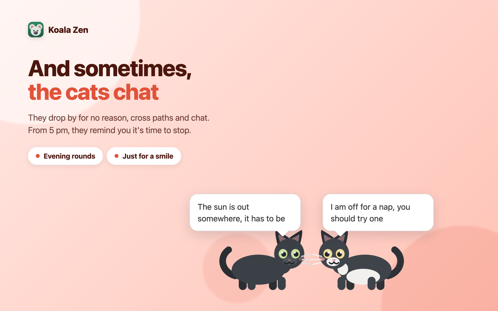
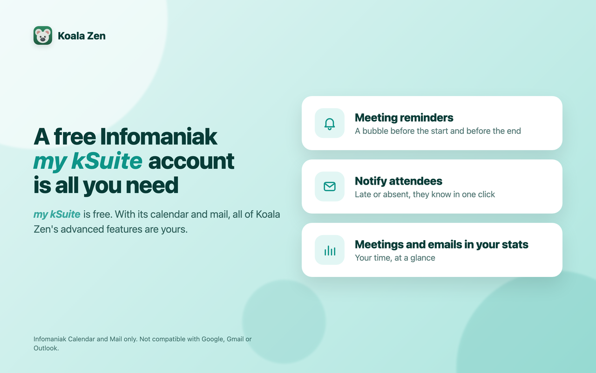

<p align="center">
  
</p>

# Koala Zen

> **English** · [Français](README.fr.md)

**A friendly koala for your workday.** It reminds you to take small breaks and build healthy habits, keeps you on time for your meetings, and shows you where your time goes. For **Chrome and Firefox**, free and open source.

- **A gentle nudge, never a guilt trip.** Every 5 to 240 minutes, a koala suggests one small thing: stand up, drink some water, look into the distance. Done or later, it's your call. Then it leaves you a short thought from about 60 hand-picked quotes. Never during a video call.
- **Never miss a meeting.** A bubble 3 minutes before, with the video link one click away, and a heads-up 5 minutes before the end. Quiet while you are in a meeting.
- **Running late? Let them know in one click.** A ready-made email to the attendees, from your own mailbox. You reread it, you send it.
- **See where your time goes.** Habits, screen time, meetings and emails, day by day, with streaks and records.
- **Make the koala yours.** Swap it for your own images or animated GIFs (up to 18), and write your own habits and quotes.
- **And sometimes, the cats chat.** For no reason at all. From 5 pm, they remind you, a little more firmly each hour, that it's time to stop.

> **A free Infomaniak *my kSuite* account is all you need** for the advanced features: its Calendar and Mail unlock meeting reminders, attendee emails and meeting and email stats. **Calendar and email work with Infomaniak only.** They are not compatible with Google Calendar, Gmail or Microsoft Outlook. Everything else, breaks, quotes, statistics and passing animals, works for everyone.

**Your data stays yours.** No account, no Koala Zen server, no tracking. Everything stays in your browser, and a backup is a file you export yourself.

**New in 2.2:** meeting reminders and attendee emails with Infomaniak, time in meetings and emails in the stats, a dark mode, a short guided tour, redrawn koalas and cats, evening and weekend rounds, and stronger security. See the [changelog](CHANGELOG.md).

---

## Overview

<table>
  <tr>
    <td width="50%" align="center"><br><sub><b>Move a little. No guilt.</b></sub></td>
    <td width="50%" align="center"><br><sub><b>Never miss a meeting again</b></sub></td>
  </tr>
  <tr>
    <td width="50%" align="center"><br><sub><b>Running late? Let them know.</b></sub></td>
    <td width="50%" align="center"><br><sub><b>See where your time goes</b></sub></td>
  </tr>
  <tr>
    <td width="50%" align="center"><br><sub><b>And sometimes, the cats chat</b></sub></td>
    <td width="50%" align="center"><br><sub><b>A free Infomaniak my kSuite account is all you need</b></sub></td>
  </tr>
</table>

---

## Install

### Firefox, in one click
Koala Zen is on Firefox Add-ons: 👉 https://addons.mozilla.org/en-US/firefox/addon/koala-zen/

You can also install [`download/koala-zen-firefox.xpi`](download/koala-zen-firefox.xpi), the same build, signed by Mozilla: open `about:addons`, click the gear icon, then **Install Add-on From File**.

### Chrome, Edge, Brave, in about a minute
Koala Zen is not on the Chrome Web Store yet, so you add it by hand. It stays installed across restarts.
1. Download [`download/koala-zen-chrome.zip`](download/koala-zen-chrome.zip) and unzip it.
2. Type `chrome://extensions` in the address bar and press Enter.
3. Turn on **Developer mode** (top-right switch).
4. Click **Load unpacked** and pick the unzipped folder (the one that contains `manifest.json`).

The koala icon appears in your toolbar. Click it to open the panel.

---

## Get started in three steps

1. **Follow the short tour.** It opens on install: pick your first habit and see what Koala Zen does for you. You can replay it from the link under the version number.
2. **Set your rhythm.** In **Settings**, choose Pomodoro (25 min), Deep work (52 min), Ultradian (90 min) or your own interval. In **Custom**, write your habits and quotes, or add your own koala.
3. **Connect your Infomaniak calendar** (optional). It takes two minutes:
   - In the Infomaniak Manager, create an **API token** ([how to](https://www.infomaniak.com/en/support/faq/2582/generate-and-manage-infomaniak-api-tokens)).
   - Tick **only** the `workspace:calendar` scope and give it an expiry date.
   - Paste it in the **Infomaniak Calendar** card, then tick the calendars to watch.

   For the email features, create a second token the same way, with **only** the `workspace:mail` scope. One token per use: Koala Zen refuses a token that opens more than it needs.

---

## What Koala Zen does

### Settings: how and when the koala shows up
- **Pause** for an hour or for the rest of the day, and resume whenever you want. Your streak is kept.
- **Focus break** (optional): the page dims for the length of the break, so you really stop.
- **Do not disturb**: never during a video call (kMeet, Teams, Zoom, Google Meet, and any site you add), never while you are away from the keyboard, and, with Infomaniak, never during your meetings. A reminder that falls during a meeting moves to the next free slot.
- **Passing animals**: now and then a cat crosses the page to say hello, sometimes two cats, or a cat and a fox. From 5 pm, a cat walks by every hour to suggest it is time to stop. On weekends, it wonders why you are working.
- **Infomaniak Calendar** (optional):
  - a blue bubble **3 minutes before** each meeting, with a countdown and **Join the call**;
  - an amber bubble **5 minutes before the end**, so you finish on time;
  - **Notify attendees**: three ready messages (5 min late, 10 min late, absent), the attendees as chips you can remove, a text you can edit, and one **Send** button;
  - **Count my emails**: only the number of emails per day, never a sender, subject or content.

### Custom: what the koala shows
- **Goals**: your own habits, in your order, and **your daily target**. Every habit beyond it counts as a bonus.
- **Quotes**: yours, or the bundled ones, which you can browse, hide or edit.
- **Characters**: two hand-drawn koalas by default, or your own PNG images and animated GIFs (up to 18).
- **Theme** (light, dark or automatic) and **animations**.

### Stats: your progress
Pick a period, from today to since you started. Habits done and postponed, screen time, time in meetings, emails handled and sent, each with a line of context. Per-day charts, your busiest weekday, your current streak and your record. The wording adapts to your own data.

### Data: your backup
- **Export** a backup file and **import** it again, in full or in part. Your Infomaniak connections are optional in the file and protected by a passphrase of at least 12 characters.
- See what Koala Zen takes up on your device.
- **Erase** the history, or everything.

---

## Privacy and security

**By default, nothing leaves your browser.** Your settings, habits, quotes, statistics and images stay on your device. No account, no Koala Zen server, no analytics, no tracking. Nothing is ever uploaded to a cloud.

Only two **optional** features use the network, both with your own Infomaniak account and your own tokens, and only once you turn them on:
- **Infomaniak Calendar** reads the events of the calendars you ticked, through `api.infomaniak.com`. Koala Zen keeps only what it needs to stay quiet and remind you (start, end, title, attendee count, video link) and a daily total of minutes in meetings. Turning it off clears that data.
- **The email features** go through `mail.infomaniak.com`. **Notify attendees** sends only when you click Send, only to the attendees you kept, and keeps nothing of them afterwards. **Count my emails** reads only how many emails you get each day.

**Your tokens.** Give each token a single scope and an expiry date. Koala Zen keeps them encrypted on your device, uses them only for what its features need, and never shows them to web pages. They leave your device only inside a backup file you export, if you choose to include them, encrypted with your passphrase. To cut access at once, revoke the token in the Infomaniak Manager, or use **Erase all** in the Data tab. Like any browser extension, Koala Zen cannot protect your tokens from malicious software already installed on your computer.

**On web pages.** The bubbles are kept apart from the site, nothing is sent without a real click from you, and an email can only go to the meeting's attendees.

**Found a security issue?** Please report it privately, see [SECURITY.md](SECURITY.md). Do not open a public issue.

---

## For developers

<details>
<summary><b>Build the packages</b></summary>

The ready-made packages are in [`download/`](download). Rebuild them only if you change the code:
```bash
bash build.sh
```
This writes `dist/koala-zen-chrome.zip` and `dist/koala-zen-firefox.xpi`. The same `manifest.json` serves both browsers; the script adapts it for Firefox.
</details>

<details>
<summary><b>Customise in the code</b></summary>

- **Default quotes and habits**: `quotes.js`.
- **Default koalas**: drawn in SVG in `KOALA_SVGS`, at the top of `content.js`.
- **Reminder timings**: the `T` object at the top of `content.js`, in milliseconds.
- **Default video-call sites**: `DEFAULTS.mutedPatterns` in `background.js` and `popup.js`.

Reload the extension after editing a file.
</details>

<details>
<summary><b>Install your own modified build on Firefox</b></summary>

Mozilla's signature covers only the unmodified file. A build you changed needs its own signature, free and for your use only:
1. In `manifest.json`, replace `"id": "koala-zen@public.extension"` with your own ID, for example `"koala-zen@your-name"`. The original ID belongs to the public listing.
2. Zip **the files inside the folder** (not the folder itself).
3. On the [Firefox developer dashboard](https://addons.mozilla.org/en-US/developers/), click **Submit a New Add-on**, choose **On your own**, and upload your zip. Mozilla gives you a signed `.xpi` to install.

To try a change without signing, open `about:debugging#/runtime/this-firefox` and click **Load Temporary Add-on**. It disappears when Firefox closes.

Prefer the terminal? `web-ext sign --channel=unlisted` does the same with an API key from Mozilla. Keep that key out of the project and out of Git.
</details>

<details>
<summary><b>Project structure</b></summary>

```
manifest.json     extension manifest (Manifest V3, Chrome and Firefox)
background.js     reminders, statistics, and the optional Infomaniak calendar and mail
content.js        the koala and the bubbles on the page
passages.js       the passing animals
quotes.js         default quotes, habits and animal lines
popup.html/js     the panel: Settings, Custom, Stats, Data
build.sh          builds the Chrome and Firefox packages
download/         ready-to-install packages
images/, icons/   welcome koala and toolbar icons
store-assets/     screenshots in three languages
tests/            automated tests
```
</details>

Not comfortable with a step? An AI assistant like **Euria by Infomaniak** can walk you through it.

---

## License
MIT. See [LICENSE](LICENSE).
