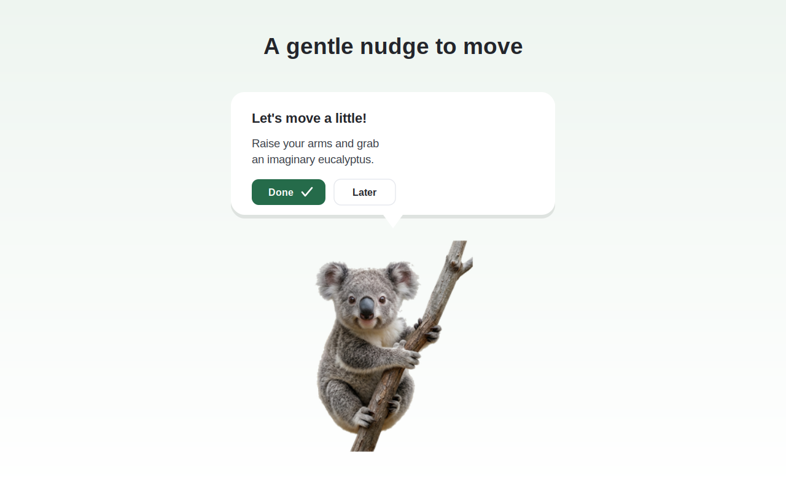
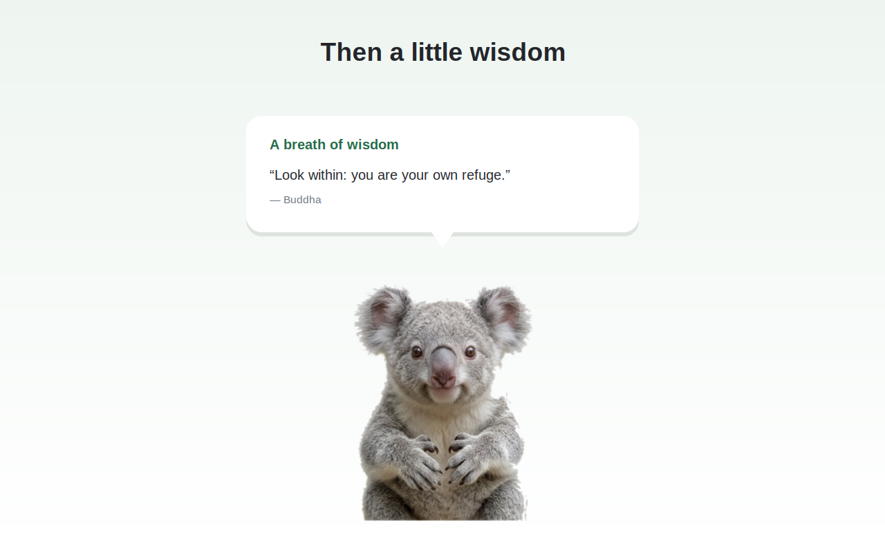
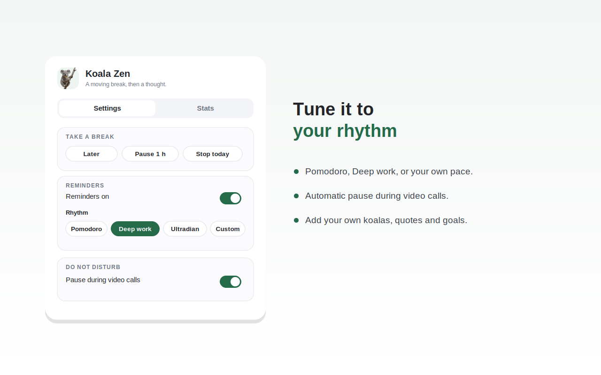
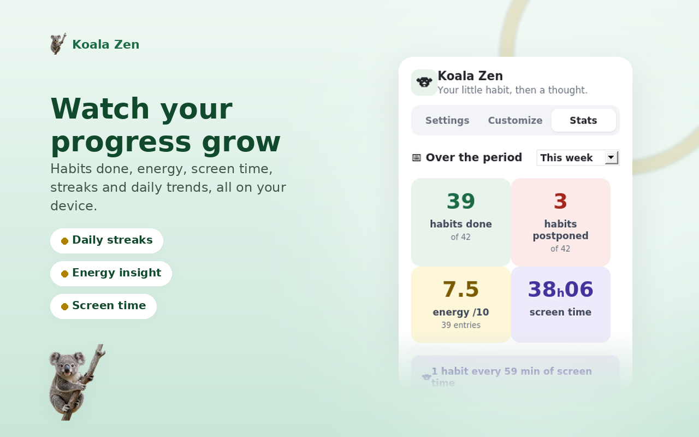

<p align="center">
  
</p>

# Koala Zen

> **English** · [Français](README.fr.md)

A small browser extension for **Chrome and Firefox**. Every 30 minutes, an adorable koala pops up on the page. First it nudges you to move a little. Then it comes back to whisper a short piece of wisdom, and leaves in a different, playful way each time. The koala changes on every visit: three photos, or your own.

- **Set your movement goals** ("Do 3 push-ups"), confirm each as done, and rate your energy from 1 to 10.
- **Follow your progress**: today, yesterday, the week, the month, or since you started, with a chart across the year.
- **Choose your rhythm**: Pomodoro, Deep work, Ultradian, or your own interval (1 to 240 minutes).
- **Snooze or pause** (later, 1 hour, the whole day) and catch up the breaks you missed.
- **Automatic pause** during video calls (kMeet, Teams, Zoom, Meet) and when you step away from the keyboard.
- **Optional focus mode**: a full-screen break that blocks the page until the timer ends. Off by default.
- **See your screen time**: the wisdom bubble, and the gentle nudge shown if you skip a break, tell you how long you have been active on the computer today. It resets at midnight in the time zone you choose (Europe/Zurich by default, or your browser's).
- Around 60 editable quotes, from Buddha and Rumi to Marcus Aurelius and Steve Jobs. Bring your own koala images too.
- **Interface in French, German, and English**, following your browser's language.
- It hops, rolls, or floats off. A new exit every time. Everything stays on your computer, no account, no tracking.

---

## Overview

The koala nudges you to move, then whispers a thought. Everything is tuned from one panel, and you follow your progress.






---

## Installation

Koala Zen works on **Chrome and Firefox**. Pick your browser below. The ready-to-use packages are in the [`download/`](download) folder, and the Firefox one is **signed by Mozilla**, so it installs directly.

### Chrome, Edge, Brave (the simplest, about a minute)
The extension isn't on the Chrome Web Store yet, so you add it by hand. It stays installed across restarts, just leave developer mode on.
1. Download [`download/koala-zen-chrome.zip`](download/koala-zen-chrome.zip) and unzip it.
2. In Chrome, type `chrome://extensions` in the address bar and press Enter.
3. Turn on **Developer mode** (the switch in the top-right corner).
4. Click **Load unpacked**, then pick the unzipped folder (the one that contains `manifest.json`).

The koala icon appears in your toolbar. Click it to open the settings.

### Firefox
The Firefox package in [`download/`](download) is **signed by Mozilla**, so it installs permanently in regular Firefox with no account and no command line.

**Install it (recommended)**
1. Download [`download/koala-zen-firefox.xpi`](download/koala-zen-firefox.xpi).
2. Open `about:addons`, click the gear icon, then **Install Add-on From File**, and pick the `.xpi` (you can also drag the file onto the Firefox window).
3. Confirm. Because the file is signed, it stays installed across restarts.

**Try it without installing (temporary)**
The extension disappears when you close Firefox.
1. Type `about:debugging#/runtime/this-firefox` in the address bar.
2. Click **Load Temporary Add-on** and pick the `.xpi`.

**If you modified the code, sign your own build (free)**
A build you changed is no longer covered by the provided signature, so you sign it for yourself. It all happens in the browser, no command line. You submit it to AMO as a **private distribution**: Mozilla signs it for your own use, with no public page.
1. Create a free Firefox account at https://accounts.firefox.com, then open the developer dashboard: https://addons.mozilla.org/en-US/developers/
2. **Set your own add-on ID.** Open `manifest.json`, find `"id": "koala-zen@public.extension"` and replace it with an ID of your own, for example `"id": "koala-zen@your-name"`. The original ID is reserved for the public page. Then select **all the files inside the folder** (not the folder itself) and compress them into a `.zip`.
3. Click **Submit a New Add-on**, choose **On your own** (private, unlisted), upload your `.zip`, and Mozilla offers a **signed** `.xpi` to download.
4. Install that signed `.xpi` the same way as above.

Not comfortable with these steps? An AI like **Euria by Infomaniak** can walk you through them. Paste it the instructions above and describe where you're stuck.

**Once the public page is live**
After Mozilla validates and publishes the extension, anyone will be able to install it in one click from:

👉 https://addons.mozilla.org/en-US/firefox/addon/koala-zen/

---

## Signing with the command-line API (alternative)
*For people comfortable with a terminal who prefer to automate the signing. The result is the same as the recommended method above: a `.xpi` signed for private use. It is more technical, so each step is spelled out.*

Your API credentials never go inside the extension. They are used only by the `web-ext sign` command, on your machine.

1. **Set your own add-on ID**, as in step 2 of the recommended method: in `manifest.json`, replace `"id": "koala-zen@public.extension"` with your own.
2. Create an API key at https://addons.mozilla.org/developers/addon/api/key/. Mozilla gives you **two** values:
   - a **JWT issuer**, the "API key" (it looks like `user:12345:678`).
   - a **JWT secret**, a long random string shown **only once**, at creation. Copy it right away. If you lose it, generate a new key.
3. Install the tool: `npm install -g web-ext`
4. From the project folder (the one with `manifest.json`), run **one** of:
   ```bash
   web-ext sign --channel=unlisted --api-key=YOUR_ISSUER --api-secret=YOUR_SECRET
   ```
   or, to keep the values out of the command line:
   ```bash
   export WEB_EXT_API_KEY="YOUR_ISSUER"
   export WEB_EXT_API_SECRET="YOUR_SECRET"
   web-ext sign --channel=unlisted
   ```
   `--channel=unlisted` means private distribution, not listed in the public gallery.
5. The signed `.xpi` lands in `web-ext-artifacts/`. Install it as in step 6 of the recommended method (drag it into a Firefox window, or `about:addons` then **Install Add-on From File**). It stays installed across restarts.

> **Keep these two values private.** Never commit them to Git or place them in any project file. The included `.gitignore` already excludes `web-ext-artifacts/`.

Need help with a step? Here too, an AI like **Euria by Infomaniak** can get you unstuck.

*Alternative without a Mozilla account (Firefox Developer Edition or ESR only):* set `xpinstall.signatures.required` to `false` in `about:config`, then open the `.xpi`. This switch is ignored on regular Firefox.

---

## Plugin settings
**Everything in Koala Zen is customizable, from one place.** Click the koala icon in the toolbar to open the plugin panel. It has two tabs, **Settings** and **Stats**. Nothing is fixed: you tune the rhythm, the images, the text and the pauses however you like.

**Settings** tab:
- **Take a break**: postpone the next appearance (**Later**), pause for **1 h**, or stop for **the day**. A **Resume** button cancels the pause at any time.
- **Reminders**: turn the koala's automatic appearances on or off. Choose your **rhythm** among **Pomodoro**, **Deep work**, **Ultradian**, or **Custom** to set the interval yourself (1 to 240 minutes).
- **Do not disturb**: **pause during video calls** (the koala never appears on the listed sites, by default `kmeet.infomaniak.com`, `teams.microsoft.com`, `teams.live.com`, `zoom.us`, `meet.google.com`, one domain per line, subdomains covered, so `zoom.us` also covers `us02web.zoom.us`) and **pause when you step away** from the keyboard.
- **Focus mode** (off by default): a full-screen break that blocks the page until the timer ends, and you choose the duration.
- **Screen time**: choose the time zone that defines your day for the screen-time counter shown in the bubbles. Pick **Automatic (browser)** to follow your browser, or select a zone from the list. Europe/Zurich by default. The counter resets at midnight in that zone. It only counts while the browser is running and you are active on the computer, and everything stays on your device.
- **Koala images**: add your own PNG or animated GIF files (a transparent background works best). They replace the three bundled koalas, unless you tick **Keep the 3 original koalas too**. Click × to remove one. Animated GIFs keep their animation, static images are resized to save space.
- **Quotes**: one per line, in the form "Text | Author" (the author is optional). Leave empty to keep the built-in ones. **Load the built-in quotes** copies them in so you can edit them.
- **Movement goals**: the short "get moving" lines, one per line. Leave empty to keep the built-in ones.

The **Bring the koala now** button triggers an immediate appearance, handy for testing your settings, and it ignores the video-call pause. Click **Save** after any change, except for images, whose add or remove applies immediately.

**Stats** tab: follow your exercises done and your average energy over the period you pick (today, yesterday, the week, the month, or since you started), with your run of consecutive days and two charts across the year.

The koala appears on the active web page, not on the browser's internal pages (`chrome://`, `about:`…), which don't allow extensions.

---

## Build the packages from source (optional)
The already-built packages are in [`download/`](download). Rebuild them only if you change the code. One script regenerates both, in `dist/`:
```bash
bash build.sh
```
- `dist/koala-zen-chrome.zip` for Chrome, Edge, Brave or the Chrome Web Store.
- `dist/koala-zen-firefox.xpi` for Firefox and addons.mozilla.org, with zero validator warnings.

The committed `manifest.json` targets both engines. For Firefox the script drops the Chrome-only `service_worker` key and sets the minimum versions that understand `data_collection_permissions`, which keeps the AMO report clean. The `dist/` folder is git-ignored.

---

## Customisation in the code
- **Default quotes and prompts** live in `quotes.js` (`KZ_QUOTES` = `{ t, a }`, `KZ_SPORT` = the movement messages). Most people can just use the settings above.
- **Default images**: replace the files in `images/` (`koala-1.png` … `koala-3.png`) and update `DEFAULT_KOALAS` at the top of `content.js`.
- **Default video-call sites**: `DEFAULTS.mutedPatterns` in `background.js` and `popup.js`.

Reload the extension after editing any file.

## Project structure
```
manifest.json     extension manifest (Manifest V3, Chrome + Firefox)
background.js     service worker: schedules reminders, applies the video-call pause, tracks daily active screen time
content.js        draws the koala, the bubble and the animations
quotes.js         the default quotes and movement prompts
popup.html/js     the settings panel
build.sh          builds the Chrome (.zip) and Firefox (.xpi) packages
download/         ready-to-install packages (Chrome .zip, Firefox .xpi)
images/           the 3 default koalas (PNG)
icons/            toolbar icons
store-assets/     listing text and screenshots for the add-on stores
```

## Privacy
Nothing leaves your browser. Your settings (frequency, on/off state, video-call list, chosen time zone, your daily screen-time counter, and any images, quotes or prompts you add) are stored locally with the browser's storage API. No servers, no analytics, no tracking.

## License
MIT. See [LICENSE](LICENSE).
